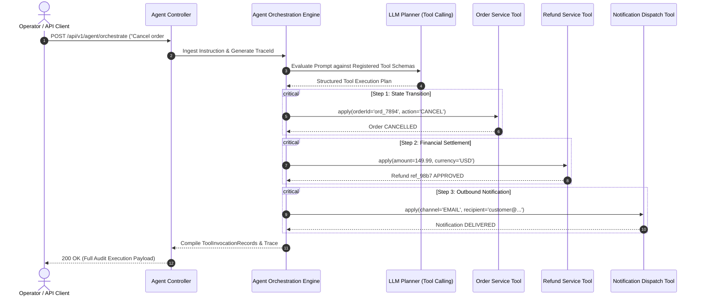

<div align="center">

# 🧠 Agentic Action Orchestrator

**An autonomous enterprise workflow orchestrator built with Java 21, Spring Boot 3, and Spring AI. Transforms natural language user intent into deterministic tool calling, transactional executions, and immutable audit trails.**

[](https://openjdk.org/)
[](https://spring.io/projects/spring-boot)
[](https://spring.io/projects/spring-ai)
[](https://platform.openai.com/)
[](https://www.docker.com/)

</div>

---

## 📌 Executive Overview

Most AI applications remain passive conversational chatbots. **Agentic Action Orchestrator** moves beyond chat to build an **autonomous action pipeline**:
1. It ingests complex, multi-clause instructions in natural language.
2. It decomposes user intent into a sequence of atomic, typed tool invocations (Function Calling).
3. It validates execution parameters, invokes backend services with strict error boundaries, and produces an audit trail with unique correlation trace IDs.

---

## 🏗️ Agentic Execution Flow



---

## 🛠️ Registered Enterprise Tools

| Tool Component | Schema Contract | Responsibility |
| :--- | :--- | :--- |
| **`OrderServiceTool`** | `(orderId, action, reason)` | Inspects lifecycle state, validates cancellation policies, and transitions orders. |
| **`RefundServiceTool`** | `(orderId, amount, currency, reason)` | Triggers automated payment refunds with cryptographic transaction IDs. |
| **`NotificationDispatchTool`** | `(recipient, channel, message)` | Dispatches real-time alerts across Email, SMS, or event webhooks. |

---

## 🚀 Quickstart Guide

### Prerequisites
- [Docker](https://www.docker.com/) or [Java 21 JDK](https://adoptium.net/)
- [Maven 3.9+](https://maven.apache.org/)

### 1. Run via Docker Compose
```bash
docker compose up -d
```

### 2. Or Run Locally via Maven
```bash
mvn spring-boot:run
```
The application boots on port **`8081`**.

---

## 🧪 Testing the Agent

### Send an Orchestration Instruction
```bash
curl -X POST http://localhost:8081/api/v1/agent/orchestrate \
  -H "Content-Type: application/json" \
  -d '{
    "prompt": "Customer requested cancellation of order ord_7894 due to delayed delivery. Please cancel it, issue a refund of $149.99, and notify the customer via email.",
    "contextUserId": "usr_ops_44",
    "dryRun": false
  }'
```

**Response Payload (HTTP 200 OK):**
```json
{
  "traceId": "trc_f823a0b12c4",
  "intentDetected": "ORDER_CANCELLATION_AND_REFUND",
  "summaryResponse": "Agent executed 3 deterministic tool action(s) for intent [ORDER_CANCELLATION_AND_REFUND]. Order ord_7894 updated and confirmed.",
  "toolInvocations": [
    {
      "toolName": "orderServiceTool",
      "arguments": {
        "orderId": "ord_7894",
        "action": "CANCEL"
      },
      "status": "SUCCESS",
      "output": "Order ord_7894 successfully marked as CANCELLED.",
      "executedAt": "2026-11-10T03:40:12Z"
    },
    {
      "toolName": "refundServiceTool",
      "arguments": {
        "amount": 149.99,
        "currency": "USD"
      },
      "status": "SUCCESS",
      "output": "Refund of 149.99 USD successfully initiated with ID: ref_98b712fa",
      "executedAt": "2026-11-10T03:40:13Z"
    },
    {
      "toolName": "notificationDispatchTool",
      "arguments": {
        "channel": "EMAIL",
        "recipient": "customer@enterprise.com"
      },
      "status": "SUCCESS",
      "output": "customer@enterprise.com",
      "executedAt": "2026-11-10T03:40:13Z"
    }
  ],
  "success": true,
  "completedAt": "2026-11-10T03:40:14Z"
}
```

---

## 📊 Documentation & Telemetry

- **Interactive OpenAPI / Swagger UI:** `http://localhost:8081/swagger-ui.html`
- **Actuator Health:** `http://localhost:8081/actuator/health`

---

## 📄 License

This repository is licensed under the [MIT License](LICENSE).
